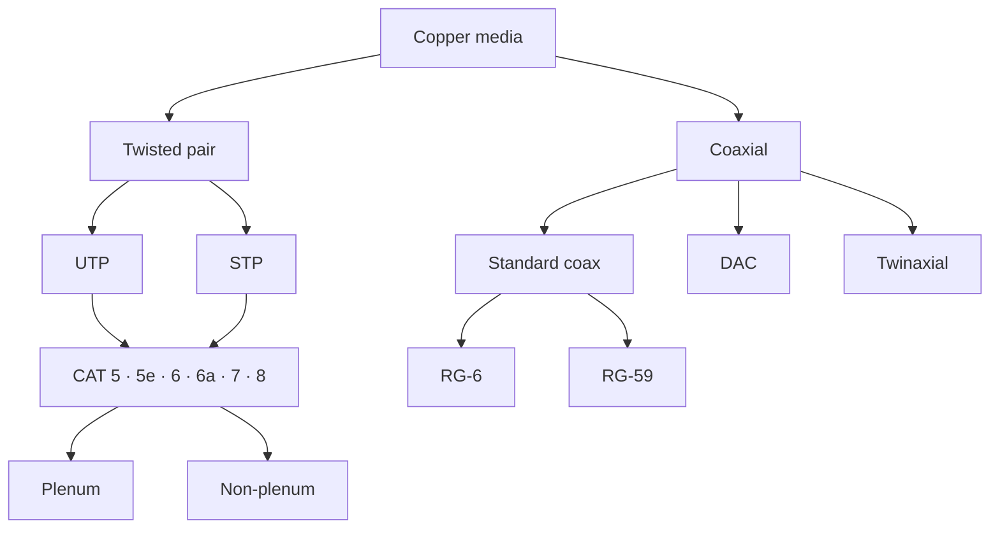

### Copper Cables

[[#^8d2f51|Copper media]] is standardized by [[#^9e3062|IEEE 802.3]] and comes in 4 primary types:
* [[#^af4173|Twisted Pair]]
* [[#^b05284|Coaxial]]
* [[#^c16395|Twinaxial]]
* [[#^d274a6|Direct Attach Copper (DAC)]]

Twisted pair comes in two variants:
* [[#^e385b7|Unshielded Twisted Pair (UTP)]]
* [[#^f496c8|Shielded Twisted Pair (STP)]]

Twisted pair cable comes in categories CAT 5, 5e, 6, 6a, 7, and 8, and each can be either [[#^05a7d9|plenum]] or [[#^16b8ea|non-plenum]]. Coax cable comes in two [[#^4b5c6d|Radio Guide (RG)]] categories, [[#^27c9fb|RG-6]] and [[#^38da0c|RG-59]].

### How Copper Cabling Is Classified

### Speeds and Distances

NOTE: Dion mentioned it is important for the exam to know the max speed and distance of the various cable types.

All CAT cables are limited to 100 m, except CAT 6, which is limited to 55 m for 10 Gbps, and CAT 8, which is limited to 30 m.

| Cable | Max speed | Max distance | Frequency |
| --- | --- | --- | --- |
| CAT 5 | 100 Mbps | 100 m | 100 MHz |
| CAT 5e | 1 Gbps | 100 m | 100 MHz |
| CAT 6 | 1 Gbps (10 Gbps at 55 m or less) | 100 m | 250 MHz |
| CAT 6a | 10 Gbps | 100 m | 500 MHz |
| CAT 7 | 10 Gbps | 100 m | 600 MHz |
| CAT 8 | 10–25 or 40 Gbps, depending on length | 30 m | |
| RG-6 | 1 Gbps | 300 m | |
| Twinaxial | 10 Gbps or more | 10 m | |
| DAC | 100 Gbps | 15 m active, 7 m passive | |

### Copper Connectors

The most common copper connectors are:
* [[#^2d3e4f|RJ-11]]
* [[#^3e4f50|RJ-45]]
* [[#^4f5061|F-type]]
* [[#^506172|BNC]]

RJ-11 and RJ-45 are both [[#^1c2d3e|Registered Jack (RJ)]] connectors. F-type and BNC are coaxial connectors.

### Building a Copper Cable

There are two wiring configurations, [[#^b8f2d1|568A]] and [[#^a7e1c0|568B]]:
* 568B is preferred for wiring jacks in buildings.
* Most cables will be 568B to 568B.
* 568A switches out pins 1, 2, 3, and 6, so the orange and green pairs swap places.

| Pin | 568B | 568A |
| --- | --- | --- |
| 1 | Orange-white | Green-white |
| 2 | Orange | Green |
| 3 | Green-white | Orange-white |
| 4 | Blue | Blue |
| 5 | Blue-white | Blue-white |
| 6 | Green | Orange |
| 7 | Brown-white | Brown-white |
| 8 | Brown | Brown |

NOTE: It is important to know how these pinouts are made for the exam.

#### Choosing Straight-Through or Crossover

Devices are either [[#^c903e2|Data Terminal Equipment (DTE)]] or [[#^d0a4f3|Data Communications Equipment (DCE)]]:
* DTE to DCE, or DCE to DTE: use a [[#^e1b504|straight-through cable]].
* DTE to DTE, or DCE to DCE: use a [[#^f2c615|crossover cable]].

NOTE: Dion pointed out that it is important to know you need a crossover cable when connecting a switch to a switch.

This is not always the case in the real world, though, as modern switches implement [[#^03d726|MDIX]], which electronically simulates a crossover cable even when using a straight-through patch cable. For the exam, assume the switch is an older device that doesn't support MDIX.

### Glossary

Copper Media: The default type of cable used in networks for decades. ^8d2f51

IEEE 802.3 Standard: Defines the physical layer and data link layer media access control (MAC) for wired Ethernet networks. ^9e3062

Twisted Pair Cable: A type of wiring in which two conductors of a single circuit are twisted together, which prevents crosstalk and EMI. The preferred method for transmitting data and voice signals. ^af4173

Unshielded Twisted Pair (UTP): Variant of twisted pair cable in which the pairs of wires have no additional shielding. The most common type. Lightweight, flexible, cost-effective, smaller, and easier to install, but more susceptible to EMI. ^e385b7

Shielded Twisted Pair (STP): Designed with a layer of insulation or shielding, which more effectively reduces noise and EMI. More expensive, bulkier, and more difficult to install. ^f496c8

CAT 5: 100 Mbps, 100 meters maximum, 100 MHz frequency. ^4a1b2c

CAT 5e: 1000 Mbps/1 Gbps, 100 meters maximum, 100 MHz frequency. Has more twists than CAT 5, reducing crosstalk. ^5b2c3d

CAT 6: 1 Gbps, 100 meters maximum, 250 MHz. If the cable is 55 m or less, supports up to 10 Gbps. ^6c3d4e

CAT 6a: 10 Gbps, 100 meters maximum, 500 MHz. ^7d4e5f

CAT 7: 10 Gbps, 100 meters maximum, 600 MHz. ^8e5f60

CAT 8: 10–25 Gbps or 40 Gbps depending on cable length, 30 m maximum. Designed for use in data centers where high-speed data transfer is crucial. ^9f6071

Coaxial (Coax) Cable: Consists of a single copper conductor at its core, with an insulating layer and a conductive shield wrapped around it. ^b05284

RG-6: A standard for coaxial cables, predominantly used in residential and commercial settings. Used to support faster internet speeds when using a cable modem. Has a heavier center copper core. 1 Gbps, 300 m max length. Compared to RG-59, offers higher bandwidth and frequency, digital television transmission, and high-speed internet. ^27c9fb

RG-59: Older coax cable that used to be very common for television and radio signal transmission, and has been widely replaced by RG-6. Now only used in analog video and closed-circuit television installations. Analog only. ^38da0c

Direct Attach Copper (DAC) Cable: Fixed-assembly copper cabling used to connect switches to routers or servers. 100 Gbps at 15 m with active cables, or 100 Gbps at 7 m with passive cables. ^d274a6

Twinaxial Cable: Often a component of a DAC assembly, and considered a specialized type of cabling. Optimized for short-distance, high-frequency transmission. 10 Gbps or more at 10 m (25 Gbps, 40 Gbps, 100 Gbps at 7 m). ^c16395

Plenum Cables: Designed with fire-retardant plastic jackets made from materials like PVC or FEP. They prevent flames from spreading, reduce the amount of smoke, and don't drip. ^05a7d9

Non-plenum Cables: Not designed with the same fire-retardant properties, and therefore not suitable for use in plenum spaces. ^16b8ea

Registered Jack (RJ-X): A standardized telecommunication network interface for connecting voice and data equipment to a service provided by a local exchange carrier or long distance carrier. X is a placeholder for a number, Ex. RJ-11, RJ-45. ^1c2d3e

RJ-11: Standard connector for telephone wiring. 6-position 2-conductor (6P2C) configuration. Smaller and ideal for telephone, but not suitable for high-speed data transmission. ^2d3e4f

RJ-45: Standard connector for data networks that use copper cables for Ethernet. 8P8C configuration. Widely used to connect devices together in a LAN and supports high-speed data transfer. Used with CAT 5, 5e, 6, 6a, 7, and 8. ^3e4f50

F-type Connector: Standard for cable television and satellite connections, and can also be used for cable internet connections. ^4f5061

Bayonet Neill-Concelman (BNC) Connector: A coaxial connector characterized by its secure bayonet locking mechanism. Used in professional video connections. Quick, secure, reliable, and stable. Erroneously called the British Naval Connector. ^506172

Radio Guide (RG-X): Used with coaxial cables for various applications like high-speed internet connections, television connections, and radio communications. X is a placeholder. The two most common are RG-6 and RG-59. ^4b5c6d

568B: The wiring configuration preferred for wiring jacks in buildings. Pins 1 to 8: orange-white, orange, green-white, blue, blue-white, green, brown-white, brown. ^a7e1c0

568A: The other wiring configuration. Switches out pins 1, 2, 3, and 6 compared to 568B, so the orange and green pairs swap places. ^b8f2d1

Data Terminal Equipment (DTE): Endpoint devices that connect to a piece of data communications equipment. Ex. laptops, desktops, servers, and routers. ^c903e2

Data Communications Equipment (DCE): Ex. switches, modems, hubs, and bridges. ^d0a4f3

Straight-Through Cable (Patch Cable): Contains the exact same pinout on both ends of the cable. Used to connect a DTE to a DCE. Most cables will be 568B to 568B. ^e1b504

Crossover Cable: Swaps the send and receive pins on the other end of the cable when the connector and its pinout are created, so one end is 568A and the other end is 568B. Used to connect DTE to DTE or DCE to DCE. ^f2c615

Medium Dependent Interface Crossover (MDIX): An automated way to electronically simulate a crossover cable, even when using a straight-through patch cable. Implemented by modern switches. ^03d726
